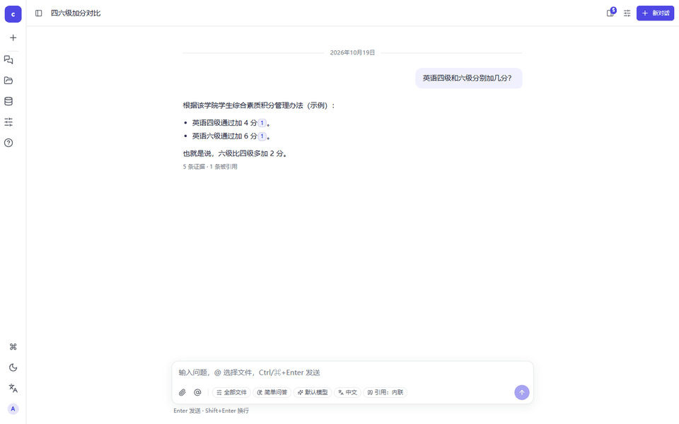
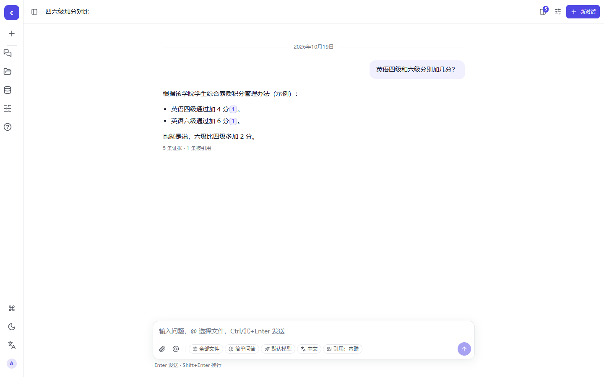
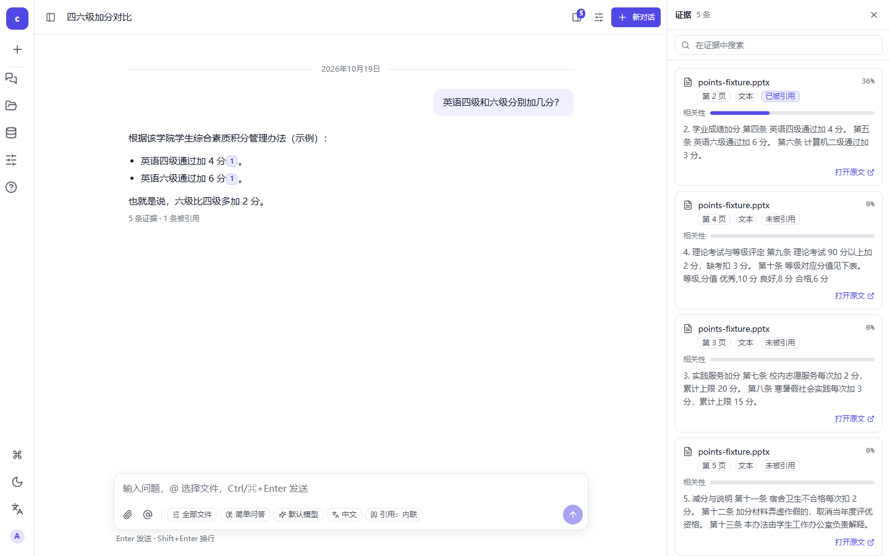
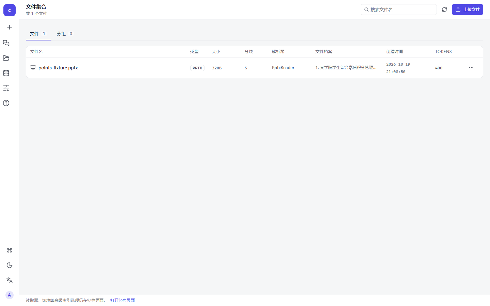

# citeask

[](https://github.com/wangwuqiang2026/citeask/actions/workflows/tests.yaml)

**把一份文档（包括扫描件、表格）变成能逐页引用、能回答细节问题的知识库。**

Document QA with OCR-aware ingestion, page-level citations, and an evaluated retrieval pipeline.



---

## 它能做什么

- **上传就能问**：PDF / Word / PPT / Excel / 网页链接 → 自动抽取、分块、向量化；**扫描版 PDF 按页 OCR**，不是只抽出标题就完事。
- **答案可溯源**：回答里的 `1` 是可点的引用标记，点开右侧证据面板，定位到**具体文件、第几页、哪一段**，并显示相关性。
- **问得具体也答得上**：问「四级加几分」「某同学综测排第几」这类**表格里的某一行**，不靠"整张表像不像问题"，而是靠实体词命中与按行补齐。
- **没有依据就拒答**：检索最高分低于阈值时直接说"知识库没有依据"，不让模型凭记忆编。
- **模型可换、数据在本地**：对话（DeepSeek 等 OpenAI 兼容接口）、向量（通义 API 或本地 FastEmbed）、重排（零依赖本地词法）都可在界面里切；语料、索引、会话全在本地 `ktem_app_data/`。
- **一套界面 + 一条回滚**：React SPA 提供对话/文件/资源/设置/帮助；经典 Gradio 界面保留在 `/legacy/`，`KH_WEB_UI=0` 可整体回滚。

## 它和"套壳 RAG"差在哪

| 做了什么 | 可验证的结果 |
|---|---|
| **修好"配了但没生效"**：默认配置下检索被整段跳过，模型绕过文档凭记忆作答 | 同一条默认路径：修复前召回 0 条 → 修复后正确命中并带引用（[§2.5](MODIFICATIONS.md)） |
| **扫描件真的进了索引**：按页决策，文字层不足才 OCR | 同一份 PDF 正文 **209 → 2322 字符**，「英语四六级加几分」得到「四级 +4 / 六级 +6」并引用第 2 页（[§2.7](MODIFICATIONS.md)） |
| **检索效果是量出来的**：自建只跑检索层、零 token 成本的评测 | 切块 A/B：Hit@1 **55.6% → 88.9%**；单文件 MRR **0.933**（[§5.7](MODIFICATIONS.md)） |
| **该拒答时拒答**：分数闸门 + 实体词降档 | 无答案题正确拒答 **91.7%**，可答题误拒 **0%**（[§5.8](MODIFICATIONS.md)） |
| **表格里的"那一行"能找回来**：中文全文 n-gram + 实体行补齐 | 「某人能评上奖学金吗」从「无法确定」变成引用其综测行；跨文件事实覆盖 **13/16 → 16/16**（[§5.19–§5.21](MODIFICATIONS.md)） |
| **全栈是自己写的**：FastAPI `/api/v1`（43 个接口，SSE 流式、HttpOnly Cookie、管理员 RBAC）+ React 18 SPA | 445 个后端用例 + 56 个前端单测，离线可跑；首屏 JS **274.40 kB** gzip |

> 这是一份 **kotaemon 的改造版**：上游提供 RAG 骨架，本仓库做的是数据入口修复、检索/评测闭环、中文本地化与全栈替换。逐条定位过程与实测见 [MODIFICATIONS.md](MODIFICATIONS.md)。

## 2 分钟跑起来

需要 Python 3.10（脚本会检查）和一个 DeepSeek API key；想要更好的向量效果再配通义 key。

```powershell
git clone https://github.com/wangwuqiang2026/citeask.git
cd citeask
Copy-Item .env.example .env      # 填 DEEPSEEK_API_KEY（可选 DASHSCOPE_API_KEY）
.\start.bat                      # 首次会自动 uv sync，然后等端口就绪再打开浏览器
```

也可以手动：

```powershell
uv python install 3.10
uv sync --python 3.10 --no-install-package llama-cpp-python
.\.venv\Scripts\python.exe -X utf8 app.py
```

打开 <http://127.0.0.1:7860>，用 `admin` / `admin` 登录——**首次部署请立刻在「设置」页改密**。

试一下：把仓库自带的示例语料 `tools/eval/fixtures/points-fixture.pptx` 上传到「文件」，等索引完成，然后在「对话」里问：

> 英语四级和六级分别加几分？

回答会给出「四级 +4 分 / 六级 +6 分」，并带上可点引用；点它，右侧证据定位到第 2 页。

- 想复现演示数据：用 `KH_APP_DATA_DIR=<临时目录>` 启动，测试与索引不会写进你真实的 `ktem_app_data/`。
- 启动失败先看日志：`ktem_app_data/logs/bootstrap-<时间>.log`（启动脚本）与 `ktem_app_data/logs/app.log`（应用）。

## 界面

| 对话与引用 | 证据面板 | 文件管理 |
|---|---|---|
|  |  |  |

「资源」页管理索引、模型池（对话 / 向量 / 重排）与用户；「设置」页是 schema 驱动的表单（改完即时生效）；「帮助」页有使用指南。

## 它是怎么工作的

```
浏览器
├─ /            React 18 + TypeScript + Vite（web/dist 已提交，运行时不需 Node）
├─ /api/v1/*    FastAPI：JSON + SSE（ktem/api → ktem/services，43 个接口）
└─ /legacy/     经典 Gradio 界面（迁移期回滚；KH_WEB_UI=0 时回到根路径）

        索引                           检索
┌──────────────────────┐      ┌──────────────────────────────┐
│ 抽取：PDF/Office/网页  │      │ 向量召回（通义 / 本地 FastEmbed）│
│  · 扫描页 → 本地 OCR   │ ───▶ │ + 中文全文（n-gram）            │
│ 分块 512/64（token）   │      │ + 本地词法重排 + 按文件/按行补齐  │
│ 向量化 → LanceDB/Chroma│      │ + 分数闸门（无依据则拒答）        │
└──────────────────────┘      └──────────────────────────────┘
```

路由只做鉴权、参数校验与序列化；业务在 `ktem/services/*`，不 import gradio，所以能脱离 UI 单测。

## 效果与评测

评测只跑**检索层**（不调用模型，零 token 成本），所以换切块/换模型/换重排都能直接对比。每个数字都有一条复现命令，见下方「复现命令」。

**公开示例语料**（仓库自带 5 页虚构 PPTX + 9 题，含 1 道无答案，新 clone 可直接复现）：

| Hit@1 | Hit@3 | Hit@5 | MRR | 关键事实覆盖 | 无答案拒答 | 可答题误拒 | P50 |
|---|---|---|---|---|---|---|---|
| **87.5%** | 87.5% | **100%** | **0.900** | **100%** | **100%** | 12.5% | 493 ms |

**真实语料（27 题）** —— 这份语料含个人信息，未随仓库发布，数字仅作效果参考：

| 检索范围 | Hit@1 | Hit@3 | MRR | 关键事实覆盖 |
|---|---|---|---|---|
| 只检索该 PDF | **88.9%** | 96.3% | **0.933** | **100%** |
| 全库（含 1 万块表格） | **77.8%** | 88.9% | 0.847 | 81.5% |

关键对照实验（同一套题）：

| 改动 | 前 | 后 |
|---|---|---|
| 按页成块 → 512/64 切块 | Hit@1 55.6% / MRR 0.707 | **88.9% / 0.933** |
| 不重排 → 本地词法重排（全库） | Hit@3 85.2% / P50 1053 ms | **88.9% / 1303 ms** |
| 每召回块调一次 LLM 打分（默认关） | 1 次调用 / 3291 token / P50 2564 ms | 11 次 / 9043 token / 2955 ms |
| 拒答阈值 0.42 → **0.45** | 无答案拒答 75% | **91.7%，可答题误拒 0%** |

细节、边界与踩坑（例如「中文全文索引对中文恒返回 0 条」「关键词命中挤掉高分块」）都在 [MODIFICATIONS.md](MODIFICATIONS.md)；评测集与结果在 [tools/eval/](tools/eval/results-public.md)。

## 配置

| 变量 | 默认 | 作用 |
|---|---|---|
| `KH_APP_DATA_DIR` | `./ktem_app_data` | 数据库、向量库、上传文件与会话密钥的根目录 |
| `KH_WEB_UI` | `1` | `1` 用 React SPA；`0` 回滚到经典 Gradio |
| `KH_UI_LANGUAGE` / `KH_ANSWER_LANGUAGE` | `zh` / 跟随界面 | 界面语言 / 模型回答语言 |
| `DEEPSEEK_API_KEY` | 空 | 对话模型（OpenAI 兼容接口） |
| `DASHSCOPE_API_KEY` | 空 | 配了就用通义 `text-embedding-v3`；不配回落到本地 FastEmbed |
| `PDF_OCR_ENABLED` / `PDF_OCR_MIN_CHARS` / `PDF_OCR_DPI` | `true` / `200` / `200` | 扫描页 OCR 开关、触发阈值、渲染精度 |
| `KH_ABSTAIN_SCORE_THRESHOLD` | `0.45` | 拒答阈值（`0` 关闭） |
| `KH_FILE_ROUTING` / `KH_RETRIEVAL_PER_FILE` / `KH_ENTITY_ROWS` | `true` / `true` / `3` | 按文件路由、按文件补齐、实体行补齐 |

## 开发

```powershell
# 后端测试（先停掉正在运行的应用：共用 sqlite / LanceDB）
# -X utf8 在 Windows 上不能省：gradio 生成类型存根时按 GBK 读组件源码会中断收集
.\.venv\Scripts\python.exe -X utf8 -m pytest libs\kotaemon\tests\test_ocr_pdf_reader.py `
    libs\kotaemon\tests\test_pptx_reader.py libs\ktem\ktem_tests tools\tests `
    -q --ignore=libs\ktem\ktem_tests\test_qa.py

# 前端（改前端才需要 Node）
cd web; npm ci; npm run dev; npm test; npm run typecheck; npm run lint; npm run build
```

- 改完前端必须 `npm run build`（Python 服务读 `web/dist`，不是 `src`），产物一并提交。
- 新增/修改的中文文案进 `web/src/lib/i18n.ts`（中英各一条）；经典界面的词表在 `libs/ktem/ktem/assets/i18n/zh.json`。
- 更多前端细节见 [web/README.md](web/README.md)。

## 已知限制

- **`.doc`（老二进制 Word）仍走 `unstructured`**：python-docx 不支持；`.xls`/`.pptx` 已改用 pandas/`python-pptx`。
- **大文件仍会摊薄小文件**：细切块把差距从 22.3 个百分点缩到 11.1，按文件配额与实体行补齐又补了一部分，但 1 万块的文档里的某一行仍可能搜不到。
- **拒答是分数闸门**：只看检索最高分（+实体词/文件名降档），不做答案级语义校验——"看似相关其实答不了"的问题仍可能通过。
- **重排是本地词法重排**：没有 cross-encoder，能纠正第 2–3 名，纠正不了"第 1 名就错了"。
- **向量化默认走通义 API**：需要网络与额度；离线用本地 FastEmbed，首次需下载约 1 GB 模型。
- **单机单用户定位**：没有多租户、限流、高并发与生产监控；新的 `/api/v1` 目前也没有接限流（`RATE_LIMIT` 仅对 `/legacy` 生效）。
- **默认口令 `admin/admin`**：首次部署请改密；没有强制改密流程。
- **收尾审计发现、本轮未修的 P2 项**（[§5.37](MODIFICATIONS.md)）：启动自愈的多索引线程共用一个 `repair_src` 目录（并发时会互相删副本）；`_dry_index` 把"合法 0-chunk 文件"当重建中断（每次点同一模型都会全库重建）；文件档案的向量缓存是进程级，切向量模型后不失效；`quick_index_mode` 把 embedding 放后台线程且异常无人接住；会话 JSON 是整列读-改-写，两个标签页同时提问可能丢一轮。

## 复现命令

<details>
<summary>每个数字对应的命令（点开）</summary>

```powershell
# 全部测试（本机实测 445 passed；前端 56 passed）
.\.venv\Scripts\python.exe -X utf8 -m pytest libs\kotaemon\tests\test_ocr_pdf_reader.py `
    libs\kotaemon\tests\test_pptx_reader.py libs\ktem\ktem_tests tools\tests `
    -q --ignore=libs\ktem\ktem_tests\test_qa.py
cd web; npm test

# Web API 契约（67 例 / 43 个接口）
.\.venv\Scripts\python.exe -X utf8 -m pytest libs\ktem\ktem_tests\test_api_auth_meta.py `
    libs\ktem\ktem_tests\test_api_conversations.py libs\ktem\ktem_tests\test_api_chat.py `
    libs\ktem\ktem_tests\test_api_files.py libs\ktem\ktem_tests\test_api_users.py `
    libs\ktem\ktem_tests\test_api_help_resources.py libs\ktem\ktem_tests\test_api_vendors.py `
    libs\ktem\ktem_tests\test_evidence_channel.py libs\ktem\ktem_tests\test_web_host.py `
    --collect-only -q
grep -c '^@router\.' libs/ktem/ktem/api/*.py

# 公开示例语料评测（先把 fixtures/points-fixture.pptx 上传进「文件」并等索引完成）
.\.venv\Scripts\python.exe -X utf8 tools\eval_retrieval.py --eval tools\eval\fixture-points.json

# 自己的语料评测（把 --corpus 换成你的文件名；应用需先停止）
.\.venv\Scripts\python.exe tools\eval_retrieval.py --eval tools\eval\zh-points-rules.json `
    --corpus "你的语料.pdf" --out tools\eval\results.md --json tools\eval\results.json

# 成本/延迟（先设 KH_QUERY_TRACE=1 问几题，再聚合）
.\.venv\Scripts\python.exe tools\trace_report.py

# 索引自检（文件是否真进了索引、配置是否真生效）
.\.venv\Scripts\python.exe tools\doctor.py

# 词表与构建产物
.\.venv\Scripts\python.exe -X utf8 -m ktem.utils.i18n stats --language zh   # 356 条
cd web; npm run build                                                       # 首屏 274.40 kB gzip
```

</details>

## 许可与上游

以 **Apache-2.0** 发布，许可证全文见 [LICENSE.txt](LICENSE.txt)。仓库包含 [kotaemon](https://github.com/Cinnamon/kotaemon) 的代码（Apache-2.0），版权归上游作者；归属说明见 [NOTICE](NOTICE)。

更深的材料：[MODIFICATIONS.md](MODIFICATIONS.md)（每处改动的定位、实测与回滚）、[ROADMAP.md](ROADMAP.md)（演进与待办）、[docs/usage.zh.md](docs/usage.zh.md)（使用指南）。
